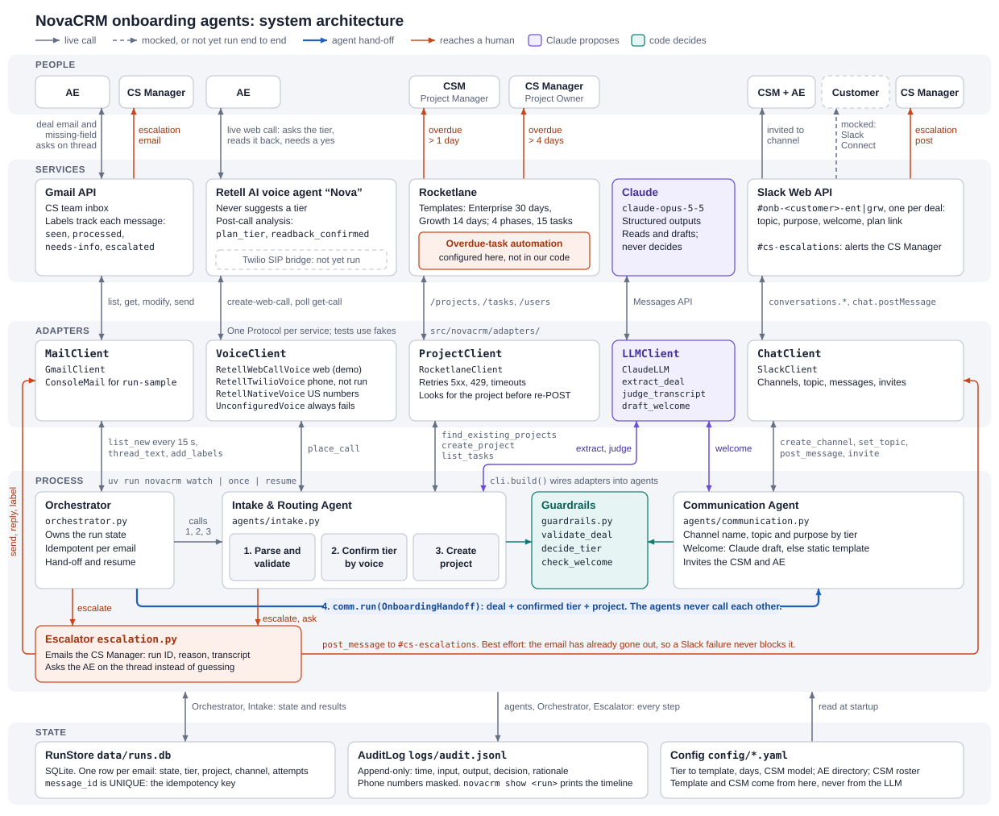

# NovaCRM Onboarding Agents

Multi-agent automation of NovaCRM's customer onboarding (Rocketlane FDE take-home).

[](docs/architecture.md)

- How it works, with the deal lifecycle and the voice call: [`docs/architecture.md`](docs/architecture.md)
- Design and assumptions: [`docs/requirements.md`](docs/requirements.md)

## Layout

| Path | What |
|---|---|
| `src/novacrm/agents/intake.py` | Agent 1: parse → validate → voice-confirm tier → create Rocketlane project |
| `src/novacrm/agents/communication.py` | Agent 2: Slack channel, topic, welcome message, invites |
| `src/novacrm/orchestrator.py` | State machine, hand-off, idempotency, resume |
| `src/novacrm/guardrails.py` | Field validation + grounding, tier acceptance rule, welcome-message check |
| `src/novacrm/escalation.py` | Human-in-the-loop: ask the AE, escalate to the CS Manager |
| `src/novacrm/audit.py` | JSONL audit log (timestamp, input, output, decision, rationale) |
| `src/novacrm/adapters/` | Gmail, Claude, Retell voice (web call or Twilio), Rocketlane, Slack |
| `config/` | Tier → template/duration/CSM model, AE directory, CSM roster |
| `tests/` | 45 offline tests with fakes for every external system |

## Setup

```bash
uv sync
cp .env.example .env          # fill in keys (see below)
uv run novacrm setup-retell   # creates the Retell voice agent; put RETELL_AGENT_ID in .env
uv run novacrm check          # verifies Rocketlane, Slack, Retell, Twilio, Claude
uv run python scripts/gmail_auth.py   # one-time Gmail consent -> secrets/token.json
```

| Service | What you need |
|---|---|
| Claude | `ANTHROPIC_API_KEY` |
| Rocketlane | API key (Settings → API); template IDs and optional field IDs in `config/settings.yaml` |
| Retell AI | API key; `setup-retell` creates the agent (prompt + post-call analysis `plan_tier`, `readback_confirmed`) |
| Twilio | Only for `voice.mode: twilio`: account SID, auth token, a number; India enabled in Voice geo permissions; AE phone verified (trial) |
| Slack | Bot token with `channels:manage, channels:read, chat:write, users:read, users:read.email` |
| Gmail | OAuth desktop client JSON at `secrets/credentials.json` (first run opens a browser to consent) |

**Voice modes** (`voice.mode` in `config/settings.yaml`):

- `web` (default, used in the demo): the AE answers a local "incoming call" page and talks to the same Retell agent over a web call. No phone number is needed. This is not a phone line.
- `twilio` (production path): Retell-purchased numbers only dial US numbers, so the call uses Retell's "dial to SIP URI" custom telephony: register the call with Retell, Twilio rings the AE and bridges to `sip:{call_id}@sip.retellai.com`. This path hasn't been run end to end yet.

### Rocketlane workspace setup

1. Users: Project Owner (CS Manager) + CSMs from `config/csm_roster.yaml`.
2. Two templates, 4 phases and 15 tasks each (see `docs/requirements.md` §4.3): Enterprise 30 days, Growth 14 days. Put their IDs in `config/settings.yaml → tiers.*.template_id`.
3. Automation "Overdue escalation": trigger *task is overdue*; > 1 day → notify Project Manager; > 4 days → notify Project Owner.

## Run

```bash
uv run novacrm watch                      # Intake Agent watches the CS inbox
uv run novacrm send-sample enterprise_ok  # (another terminal) AE sends a deal email
uv run novacrm runs                       # run states
uv run novacrm show <run_id>              # audit timeline for one run
uv run novacrm resume                     # finish runs parked while Rocketlane was down
uv run pytest                             # offline test suite
```

Samples (`samples/deals.yaml`): `enterprise_ok`, `growth_ok`, `missing_fields`, `malformed`, `not_a_deal`.

## Guardrails

- Required fields must be present, valid **and found verbatim in the email**; otherwise the agent replies on the thread asking for them.
- No project until the AE gives a clear tier on the call, confirms the read-back, and an independent Claude read of the transcript agrees. No answer → 3 calls, then escalate. Unclear → 1 re-call, then escalate. No default tier, ever.
- Template, duration and CSM come from config keyed by the confirmed tier, never from the LLM.
- Duplicate check before creation; the Salesforce opportunity link is stored in the project's "Salesforce Opportunity" field; re-runs adopt rather than duplicate.
- Rocketlane 5xx/timeouts retry with backoff, then the run is parked and the CS Manager is told.
- Welcome message checked for tier consistency, with a static fallback.
- Every step audited to `logs/audit.jsonl`; phone numbers masked.

## Production changes

Gmail Pub/Sub push instead of polling · Retell/Twilio webhooks · Postgres + tracing instead of SQLite/JSONL · secrets manager · paid Slack Connect · Salesforce API for AE phone and a tier cross-check · scheduled resume of parked runs.
