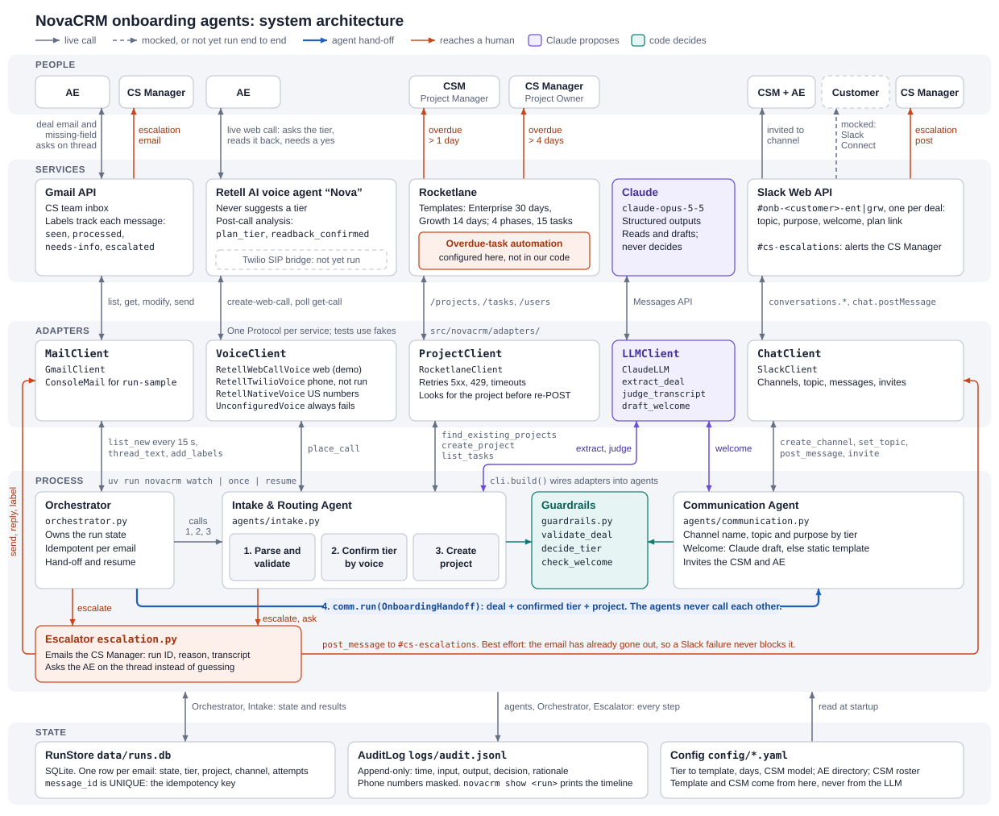
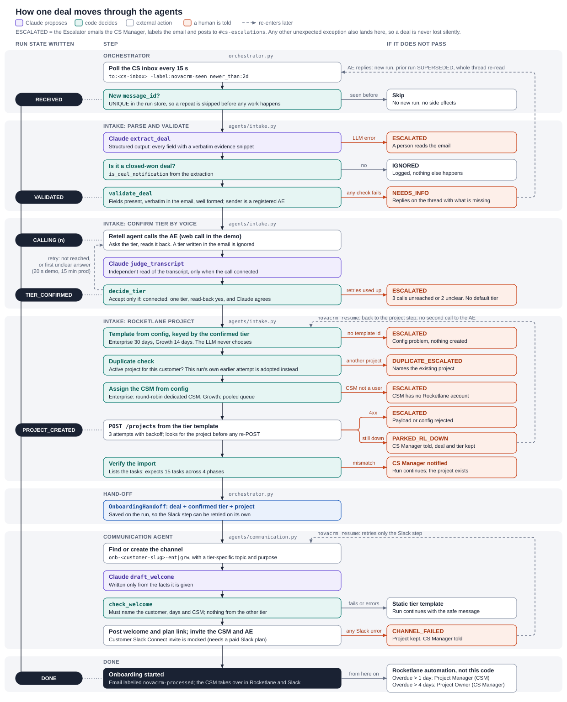
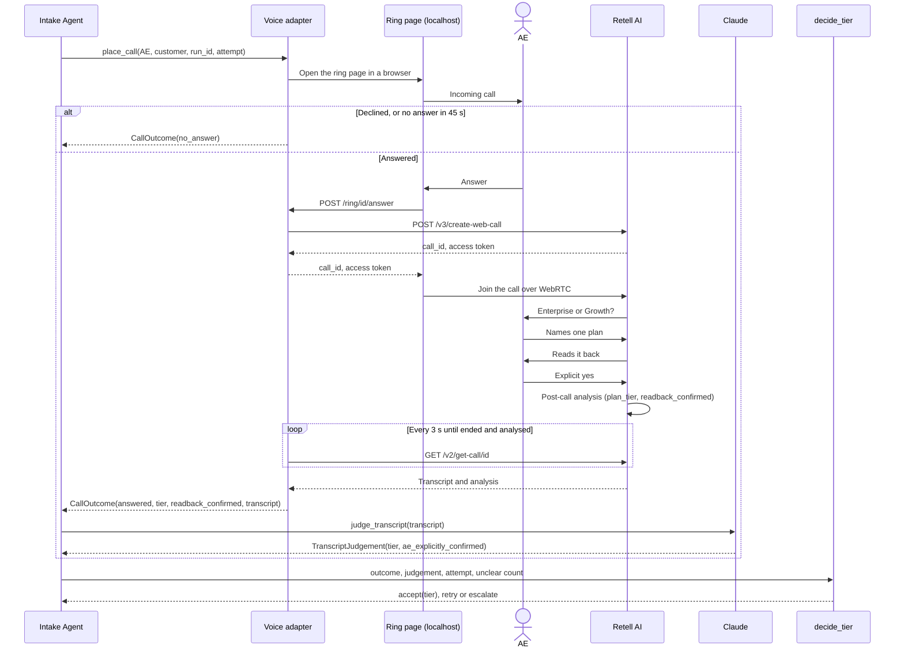

# How the NovaCRM onboarding agents work

A closed deal arrives as an email. The agents confirm the plan tier with the Account Executive (AE) by voice, create the Rocketlane project from the right template, and set up the customer's Slack channel. A person is pulled in only when something can't be trusted.

This page shows how the code works. The reasoning and assumptions are in [`requirements.md`](requirements.md).

## 1. The system

*Read it top to bottom: who is involved, the service they touch, the adapter that wraps it, and the code that calls it. Click the image for full size.*

- **Claude proposes, code decides.** Claude reads the email, reads the call transcript and drafts the welcome message. Whether to accept any of that is decided by plain, unit-tested rules in `guardrails.py`.
- **The agents never call each other.** The Orchestrator runs the Intake Agent's three steps, builds an `OnboardingHandoff` from the result, and passes it to the Communication Agent. Because the hand-off is saved on the run, the Slack step can be retried on its own.
- **Every external service sits behind a Protocol.** The 45 offline tests swap in fakes from `tests/fakes.py`, so they run without keys or network access.
- **Overdue escalation runs inside Rocketlane.** It's a Rocketlane automation, not this code, so it keeps working when the agents are offline.

**Not live in this build** (dashed in the diagram):

- The customer's Slack Connect invite is mocked, because it needs a paid Slack plan.
- The Twilio phone path hasn't been run end to end. The demo uses a Retell web call.
- The customer isn't invited to the Rocketlane project (`invite_customer: false`).

## 2. One deal, start to finish

*Left column: the state written to the run store. Middle: the steps in order. Right: where the run goes when a step doesn't pass. Red means a person is told.*

### What protects a deal when something fails

| What can go wrong | What happens | Where |
|---|---|---|
| The same email is seen twice | `message_id` is unique in the run store and checked before a run is created. The `novacrm-seen` label also keeps it out of the next poll. | `Orchestrator.handle_email` |
| The AE answers a request for missing fields | The reply starts a new run that re-reads the whole thread. The old run becomes `SUPERSEDED`. | `Orchestrator.handle_email` |
| A create request times out but the project was created | The client looks for the project by exact name before any retry, so it never blindly posts again. | `RocketlaneClient.create_project` |
| The process crashes after creating the project | The re-run sees this run's `project_create_attempted` flag and the opportunity ID in the project's field, and adopts the project. | `IntakeAgent.create_project` |
| Rocketlane stays down (5xx, 429, timeouts) | The run is parked with the deal and tier saved, and the CS Manager is told. `novacrm resume` continues without calling the AE again. | `IntakeAgent.create_project`, `Orchestrator.resume` |
| Slack fails after the project exists | The run becomes `CHANNEL_FAILED`. `novacrm resume` retries only the Slack step, and an existing channel is reused. | `Orchestrator._project_and_channel` |
| Rocketlane stops responding during the import check | The check is skipped and logged, and the run continues because the project exists. | `IntakeAgent.create_project` |
| Anything else | A catch-all marks the run `ESCALATED` and emails the CS Manager. | `Orchestrator.handle_email` |

## 3. One tier-confirmation call

The email doesn't carry the plan tier, and a tier written in it is ignored, so this call is the only source. This is one attempt in the demo's `web` mode:

### How `decide_tier` rules

| Call result | Count so far | Decision |
|---|---|---|
| Connected, Retell has one tier with a read-back yes, and Claude independently reads the same tier and a clear yes | Any | **Accept** |
| Not reached: no answer, busy, voicemail or API failure | Call 1 or 2 | Retry |
| Not reached | Call 3 | **Escalate** |
| Connected, but anything in the first row is missing | First unclear answer, on call 1 or 2 | Call again |
| Connected, but anything in the first row is missing | Second unclear answer, or call 3 | **Escalate** |

Calls are 20 s apart in the demo and would be 15 minutes apart in production. There is no default tier: if the AE can't be reached or is unclear, a person decides, and no project is created.

### How the call reaches the AE

`voice.mode` in `config/settings.yaml` selects the transport. The Retell agent, its prompt and the post-call analysis are the same in all of them.

| Mode | Adapter | How the AE is reached | Status |
|---|---|---|---|
| `web` (default) | `RetellWebCallVoice` | Local "incoming call" page on `localhost:8766`; the browser joins Retell over WebRTC | Used in the demo. Not a phone line. |
| `twilio` | `RetellTwilioVoice` | Retell registers the call, then Twilio rings the AE's phone and bridges to `sip:{call_id}@sip.retellai.com` | Production path, not yet run end to end |
| `retell_number` | `RetellNativeVoice` | Retell dials from its own number | US destinations only |
| None configured | `UnconfiguredVoice` | Every call fails, so the tier guardrail escalates | Fails safe |

In demo recordings, adding `?ae=enterprise` or `?ae=ambiguous` to the ring page replaces the microphone with scripted voice clips. The live Growth run uses a real voice.

## 4. What moves between the steps

These contracts are in `src/novacrm/models.py`. Claude's output is only ever a proposal until a rule has checked it.

| Contract | Produced by | What it is |
|---|---|---|
| `InboundEmail` | Gmail adapter | Raw input, treated as data rather than instructions |
| `DealExtraction` | Claude | Not trusted yet: a proposal with evidence for each field |
| `ParsedDeal` | `validate_deal` | Every value was found verbatim in the email; the AE's phone comes from the directory |
| `CallOutcome` | Voice adapter | Retell's post-call analysis of the call |
| `TranscriptJudgement` | Claude | A second, independent read of the transcript |
| `TierDecision` | `decide_tier` | A deterministic rule over the two results above |
| `ProjectResult` | Intake Agent | Returned by Rocketlane after the template import |
| `OnboardingHandoff` | Orchestrator | Everything the Communication Agent needs: deal, confirmed tier, project |
| `ChannelResult` | Communication Agent | The channel that was created, stored and logged |

Every step also writes to `logs/audit.jsonl` with its time, input, output, decision and rationale, with phone numbers masked. `novacrm show <run_id>` prints that timeline for one run.

## 5. What changes in production

Gmail push instead of polling, webhooks instead of polling Retell, Postgres and tracing instead of SQLite and JSONL, a secrets manager, paid Slack Connect, and Salesforce as the source for AE details and a tier cross-check. The full list is in [`requirements.md` §8](requirements.md#8-what-changes-in-production).
