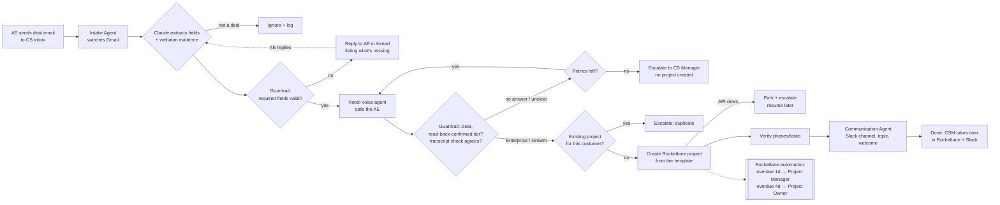

# NovaCRM Customer Onboarding Automation: Requirements & Workflow Analysis

**Author:** Subburajan Perumal, Forward Deployed Engineer candidate · **Date:** 3 Nov 2026
**Scope:** Part 1 of the Rocketlane FDE take-home. Parts 2–4 (agents, guardrails, tests) are in the repository; this document is the design they implement.

---

## 1. What Priya told us, distilled

NovaCRM (~200 customers) onboards every closed deal by hand. The CS team's process, as described in discovery:

| # | Step today | Who | Tool |
|---|---|---|---|
| 1 | AE emails the CS inbox: customer name + Salesforce opportunity link | AE | Gmail |
| 2 | CS creates a project from the standard onboarding template (~15 tasks, 4 phases: Kickoff, Data Migration, Configuration, Go-Live) | CS Manager / CSM | Asana |
| 3 | CS creates a shared Slack channel with the customer and schedules the kickoff call | CSM | Slack, calendar |
| 4 | Each phase runs off a checklist; tasks are updated as work happens | CSM | Asana |
| 5 | Tasks blocked > 3 days should be escalated | CSM → CS Manager | (manual, often missed) |
| 6 | At the end: handoff summary, customer moves to the support team | CSM | Docs, support tool |

Two plan tiers change the shape of onboarding:

| | Enterprise | Growth |
|---|---|---|
| Onboarding length | 30 days | 14 days |
| CSM model | Dedicated CSM | Pooled CSM |

## 2. Pain points and what causes them

| Pain point (Priya's words) | Root cause | What the solution must do |
|---|---|---|
| "We sometimes mix up the templates." | Tier is not in the AE's email; a person picks the template from memory. | Make the tier an explicit, verified input. Map tier → template by configuration, never by judgment. |
| "Escalation falls through the cracks." | Escalation relies on someone noticing a stale task. | Escalate automatically from the system of record (Rocketlane automation), on a fixed schedule. |
| "Data migration tasks were marked done but the data wasn't verified." | "Done" is self-reported by the CSM; the customer never signs off. | Add an explicit customer verification task with approval, and make Go-Live depend on it. |
| Manual project + channel setup for every deal | Repetitive work across 3 tools | Automate intake → project → channel end to end, with a human only on exceptions. |
| Inconsistent kickoff experience | Channel names, topics and first messages are ad hoc. | Generate a consistent, tier-specific channel and welcome message. |

## 3. Proposed agentic workflow

### 3.1 Components

| Component | Responsibility | Technology |
|---|---|---|
| **Intake & Routing Agent** | Watch the CS inbox; extract and validate deal details; call the AE to confirm the tier; check for duplicates; create the Rocketlane project from the right template; verify it. | Python, Gmail API, Claude (structured outputs), Retell AI voice agent, Rocketlane REST API |
| **Communication Agent** | Create the onboarding Slack channel; set a tier-specific name, topic and purpose; post a personalized welcome; invite the CSM and AE; invite the customer (Slack Connect). | Slack Web API, Claude with a deterministic post-check |
| **Orchestrator** | Owns the run state machine, the hand-off between agents, idempotency and resumption. | Python, SQLite |
| **Rocketlane automation** | Overdue-task escalation inside Rocketlane (not an agent). | Rocketlane Automations |
| **Audit log** | Every action with timestamp, inputs, outputs, decision and rationale. | JSONL + `novacrm show <run>` timeline |

### 3.2 Why this split

- **The LLM proposes, code decides.** Claude does what it is good at (reading free-form email, judging a transcript, writing a friendly message). Every decision that can cost money or trust (tier, template, CSM, duplicate, retry, escalate) is a deterministic rule in `guardrails.py`, unit-tested.
- **Two agents, one hand-off contract.** The Intake Agent finishes with an `OnboardingHandoff` (deal + confirmed tier + project). The Communication Agent needs nothing else, so it can be re-run on its own (e.g. if Slack fails after the project exists).
- **Rocketlane stays the system of record.** Escalation for overdue work lives in Rocketlane's own automation, so it keeps working even if the agents are offline.

### 3.3 Run state machine

`RECEIVED → (IGNORED | NEEDS_INFO → SUPERSEDED) → VALIDATED → CALLING(n) → TIER_CONFIRMED | ESCALATED → PROJECT_CREATED | DUPLICATE_ESCALATED | PARKED_RL_DOWN → (CHANNEL_FAILED) → DONE`

Each run is keyed by the Gmail message ID (idempotent), and the Salesforce opportunity link is stored in the project's "Salesforce Opportunity" field, so a crash between "project created" and "state saved" is recovered by adopting the project, not duplicating it. Project creation is never blindly re-posted: a timed-out POST is checked for a project it may have created before any retry (a real bug found and fixed during live testing).

## 4. Detailed behavior

### 4.1 Intake: parse and validate

- Inbox: a dedicated CS address (`subburajanperumal+novacrm-cs@gmail.com` in the demo), polled every 15 s; processed mail is labelled (`novacrm-seen`, `-processed`, `-needs-info`, `-escalated`).
- Claude extracts: customer name, contact name, contact email, AE name, Salesforce opportunity URL, close date, notes, each with a **verbatim evidence snippet**.
- **Required:** customer name; customer contact email (valid format, not a NovaCRM or AE address); Salesforce Opportunity URL (Salesforce domain + `006…` ID); sender must be a registered AE with a phone number on file.
- **Grounding check:** any value that does not literally appear in the email is treated as missing. The agent never fills gaps.
- On failure, the agent replies on the AE's thread listing exactly what is missing (Reply-To is the CS inbox). When the AE replies, the whole thread is re-read and the deal continues.

### 4.2 Intake: confirm the tier by voice

- The email does not carry the tier, and a tier written in the email is ignored for decision purposes: only the AE's spoken confirmation counts.
- A Retell AI voice agent calls the AE. Script: ask "Enterprise or Growth?", read the answer back, require an explicit yes. Never suggest a tier.
- **Transport.** Production: the same agent rings the AE's mobile (number from the AE directory) over a Twilio number, bridged to Retell by SIP, because Retell-owned numbers only dial US numbers. Demo: calling Indian mobiles needs a paid or ID-verified telephony account, so the video uses Retell's web-call transport: the AE answers an "Incoming call" page and has the same live voice conversation. Decline, or no answer within 45 s, counts as "no answer". Switching is one config value (`voice.mode: twilio`).
- Retell's post-call analysis returns `plan_tier` (Enterprise / Growth / Unclear) and `readback_confirmed`. Claude then reads the transcript independently.
- **Accept only if** the call connected, the voice agent captured exactly one tier, the AE confirmed the read-back, and the independent transcript check agrees.
- **No answer / busy / voicemail:** retry up to 3 calls in total (demo: 20 s apart; production: 15 min).
- **Unclear answer:** one re-call (max 2 unclear calls), then escalate.
- **Escalation:** email the CS Manager with the run ID, reason and transcript; label the deal email; post to `#cs-escalations`. No project or channel is created.

### 4.3 Intake: create the Rocketlane project

| | Enterprise | Growth |
|---|---|---|
| Template | "NovaCRM Onboarding – Enterprise (30 days)" | "NovaCRM Onboarding – Growth (14 days)" |
| Due date | start + 29 days | start + 13 days |
| CSM (team member + "Project Manager" user field) | Dedicated CSM, round-robin from the roster | Pooled CSM queue |
| Project Owner | CS Manager | CS Manager |

- Template IDs come from configuration, keyed by the confirmed tier. The LLM never chooses them.
- Duplicate check first: by Salesforce opportunity ID and by customer name. A match escalates instead of creating.
- After creation the agent lists the project's tasks and compares them with the template (15 tasks, 4 phases).
- Rocketlane errors: 5xx / 429 / timeouts retry 3 times with exponential backoff; then the run is **parked** and the CS Manager is told; `novacrm resume` finishes it later without calling the AE again. 4xx errors (bad config) escalate immediately.

**Template (both tiers, 15 tasks):**

| Phase | Tasks | Enterprise days | Growth days |
|---|---|---|---|
| Kickoff | AE→CS handoff review · Schedule kickoff call · Kickoff held + success criteria agreed · Customer workspace access provisioned | 1–5 | 1–2 |
| Data Migration | Data export received · Field mapping approved · Test migration run · Production migration run · **Customer data verification sign-off** (customer approval) | 6–15 | 3–7 |
| Configuration | Workspace & users configured · Pipelines & custom fields · Integrations connected · Admin training | 16–24 | 8–11 |
| Go-Live | Go-live readiness check (depends on the data sign-off) · Go-live + handoff summary to Support | 25–30 | 12–14 |

### 4.4 Communication Agent

- Channel name: `onb-<customer-slug>-ent|grw` (Slack naming rules; reused if it already exists).
- Topic: `<Tier> onboarding · <N>-day plan · <Dedicated|Pooled> CSM: <name> · Go-live target <date>`.
- Purpose: customer + link to the Rocketlane project.
- Welcome message: drafted by Claude from facts only, then checked: it must name the customer, the right number of days and the CSM, and must not mention the other tier, its timeline, or (for Growth) a dedicated CSM. On any failure the static tier template is used.
- Invites the CSM and AE. Customer invite via Slack Connect is **mocked** in the demo (needs a paid Slack plan; production calls `conversations.inviteShared`).

### 4.5 Rocketlane automation: overdue escalation

Configured in Rocketlane (Automations), not in code:

- Trigger: task is overdue.
- Block 1: overdue by more than 1 day → notify the **Project Manager** (the CSM).
- Block 2: overdue by more than 4 days → notify the **Project Owner** (CS Manager).

Priya's original rule, "blocked > 3 days", is about blocked status rather than due dates. I'd add it as a second automation (status = Blocked for 3 days → notify the Project Owner) once NovaCRM confirms how "blocked" is tracked (see Q6).

## 5. Guardrails (summary)

| # | Guardrail | Where |
|---|---|---|
| G1 | Required fields present, well-formed and **grounded in the email text**; otherwise ask the AE | `guardrails.validate_deal` |
| G2 | Only registered AEs can trigger onboarding (and only they get called) | AE directory |
| G3 | No project until a clear, read-back-confirmed tier, agreed by an independent transcript check; retry, then escalate; never default | `guardrails.decide_tier` |
| G4 | Tier written in the email is ignored for decisions | Intake Agent |
| G5 | Template, duration and CSM come from configuration keyed by tier, never from the LLM | `IntakeAgent.build_payload` |
| G6 | Duplicate check before creation; idempotency per email and per opportunity; no blind re-POST after a timeout | Orchestrator, Rocketlane client |
| G7 | Post-creation verification of the template's tasks | Intake Agent |
| G8 | Welcome message checked for tier consistency, with a safe fallback | `guardrails.check_welcome` |
| G9 | Email and transcript content treated as data, not instructions (prompt-injection resistance) | LLM system prompts |
| G10 | Every action logged with timestamp, input, output, decision and rationale; phone numbers masked | `audit.jsonl` |
| G11 | Secrets only in environment variables; nothing in code or logs | `.env` |

## 6. Assumptions

The deadline left no time for a round-trip with Karthik, so these are the assumptions behind the build. Each is a one-line change if wrong.

1. **Rocketlane replaces Asana** as the project tool (the brief asks for Rocketlane).
2. **AE phone numbers** come from an AE directory (in production: Salesforce User records), because the email doesn't carry them.
3. **Required fields** are customer name, customer contact email and the Salesforce opportunity link; contact name, close date and notes are optional.
4. **The AE is the authority on tier.** A tier written in the email or in Salesforce is not used to decide; in production I would cross-check against the Salesforce opportunity and escalate on a mismatch.
5. **Retry policy:** 3 calls in total, 15 minutes apart in production (20 s in the demo), at most 2 calls that connect without a clear answer.
6. **"Project Manager" = the assigned CSM; "Project Owner" = the CS Manager.**
7. **Dedicated CSMs are assigned round-robin;** Growth deals go to one pooled CSM queue.
8. **Onboarding starts the day the tier is confirmed;** 30/14 days are calendar days, inclusive.
9. **One onboarding project per customer.** An active project for the same customer or opportunity means "escalate, don't create".
10. **Slack:** the channel is created in NovaCRM's workspace and shared with the customer via Slack Connect (mocked here: free plan).
11. **Kickoff scheduling** is announced in the welcome message and owned by the CSM; calendar booking is out of scope for this round.
12. **Handoff summary to support** at the end of onboarding is out of scope for this round (see §8).

## 7. Questions I'd confirm with NovaCRM

1. Is the AE's email format consistent (template or Salesforce-generated), or free-form?
2. Where do AE phone numbers live today, and may the agent call outside business hours?
3. If the AE stays unreachable, who decides the tier: CS Manager, Sales Ops, or Salesforce data?
4. How many dedicated CSMs are there, and is assignment by capacity, region or round-robin?
5. Should the customer contact be invited to the Rocketlane project at creation, or after kickoff?
6. How is "blocked" tracked today (a status, a tag, a comment)? That decides the blocked-3-days automation.
7. Does the Slack workspace have Slack Connect, and who must approve external channels?
8. Should a Growth customer upgrading to Enterprise mid-onboarding switch templates?

## 8. What changes in production

| Demo choice | Production |
|---|---|
| Polling Gmail every 15 s | Gmail `users.watch` → Pub/Sub push; a worker queue |
| Polling Retell for call results | Retell and Twilio webhooks into the orchestrator |
| Retell web call answered on a local page | Twilio (or local carrier) number ringing the AE's mobile; business-hours calling window, local caller ID |
| SQLite run store, local JSONL audit | Postgres + a managed log/trace store (OpenTelemetry), retention policy |
| `.env` secrets | Secrets manager, per-environment keys, rotation |
| Slack Connect invite mocked | Paid Slack plan, `conversations.inviteShared` + admin approval flow |
| AE directory YAML | Salesforce API: AE profile, opportunity details, tier cross-check |
| Manual `resume` | Scheduled retry of parked runs with alerting |
| Out of scope | Handoff-summary agent at Go-Live, kickoff-scheduling agent, blocked-task automation |

## 9. How the deliverables map to the brief

| Brief item | Where |
|---|---|
| Part 1 – requirements | this document |
| Agent 1 – Intake & Routing | `src/novacrm/agents/intake.py` |
| Agent 2 – Communication | `src/novacrm/agents/communication.py` |
| Rocketlane overdue automation | configured in Rocketlane; shown in the video |
| Part 3 – guardrails | `src/novacrm/guardrails.py`, `escalation.py`, `audit.py` |
| Part 4 – automated tests | `tests/` (42 tests, offline; `uv run pytest`) |
| Video – positive and negative runs | Loom link in the submission email |
